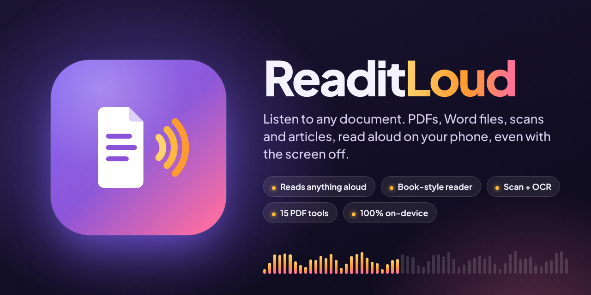
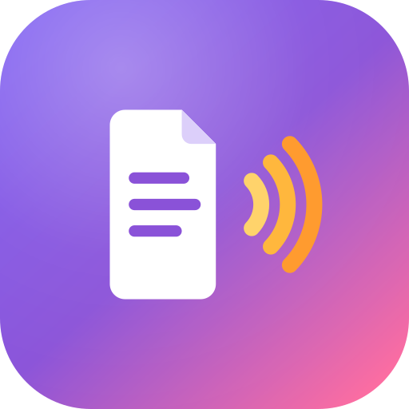
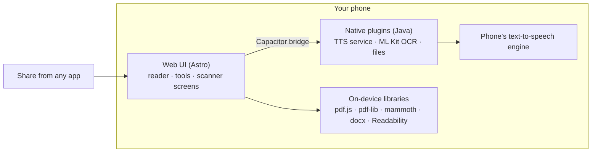

<p align="center">
  
</p>

<p align="center">
  <br>
  <strong>An Android app that reads any document aloud, scans paper into PDFs and edits PDFs.</strong><br>
  Everything runs on your phone. No signup, no ads, no uploads.<br>
  <a href="https://sankettheinventor.github.io/ReaditLoud/">Website</a> · <a href="https://sankettheinventor.github.io/ReaditLoud/#docs">Build guide</a>
</p>

<p align="center">
  
  
  
  
</p>

---

## Why ReaditLoud

Most of what we need to read arrives as a PDF, a Word file or a long article, and most of it we never get round to. ReaditLoud turns any of it into something you can **listen to**, on the commute, while cooking or with the screen off. It does the rest of the paperwork too, scanning, OCR and PDF tools, without sending a single page to a server.

## Features

- **Listen to anything.** PDFs, Word files, scans and web articles, read aloud with your phone's own voices. Playback continues in the background with a media notification, and resumes where you stopped. Choose the voice and speed, and watch a live wave visualizer while it reads.
- **A reader you'll enjoy.** Book mode with real page flips, plus Scroll and Grid views, highlights in colour and notes, all saved on the device.
- **Share to listen.** Share an article or PDF from any app to ReaditLoud. It extracts just the article text (Mozilla Readability), with no menus and no clutter.
- **Scan.** Auto-cropped document scans saved as PDF (ML Kit document scanner), QR codes, and text from any photo (ML Kit OCR).
- **15 PDF tools.** Merge, compress, organise, split, remove or extract pages, rotate, page numbers, watermark, and conversions between PDF, Word, JPG and text, plus a full read-and-edit studio.
- **My Files.** Recent documents, folders and highlights, kept in the app's private storage.

## How it works



The UI is an Astro site bundled into a Capacitor Android app. Heavy lifting happens on the device: pdf.js renders, pdf-lib edits, mammoth and docx handle Word files, and Readability extracts articles. Java plugins add what the web can't do well: a foreground **TTS service** for screen-off listening, **ML Kit** for scanning and OCR, folder access, sharing and file handling.

| Native plugin | What it does |
|---|---|
| `TtsPlugin` + `TtsService` | Read-aloud through the phone's TTS engine, kept alive in the background with a media notification |
| `TextOcrPlugin` | On-device text recognition (ML Kit, Latin) |
| `IncomingFilePlugin` | Receives files and links shared from other apps |
| `FolderAccessPlugin`, `FileActionsPlugin`, `FileDownloadPlugin` | Saving, opening, sharing and downloading files |
| `HeicPlugin` | Decodes iPhone HEIC photos |

## Privacy

- **Your documents never leave your phone.** There is no server, no account, no ads, no analytics and no tracking SDK.
- **The app bundle makes no remote requests.** A strict Content-Security-Policy limits it to local content. The only time it reaches the internet is when *you* open a link you pasted or shared, or download an extra offline voice.
- **No secrets in this repository.** No API keys, ad IDs or signing keys. Release signing reads `android/keystore.properties`, which is gitignored and stays on your machine.

## Build it yourself

You need **Node 22**, **JDK 21** and, for running on a phone, **Android Studio** (or just the Android SDK).

```sh
npm ci                                  # install (lockfile-exact)
PUBLIC_APP_BUILD=1 npm run build        # build the app bundle into dist/
npx cap sync android                    # copy it into the Android project
cd android && ./gradlew assembleDebug   # debug APK → android/app/build/outputs/apk/debug/
```

Or open the project in Android Studio with `npx cap open android` and press **Run** with your phone connected.

**No laptop?** Every push to `main` runs **Actions → Build APK**, which produces a debug APK you can download from the run's artifacts.

**Web version.** `npm run dev` serves the same tools as a website at `http://localhost:4321`. Set your domain in `astro.config.mjs` (`site`) before deploying.

### Release build (your own key)

Create `android/keystore.properties` next to your keystore, never committing either:

```properties
storeFile=release.jks
storePassword=...
keyAlias=...
keyPassword=...
```

Then run `./gradlew bundleRelease` for a Play Store bundle. Change the app ID `com.readitloud.app` in `capacitor.config.json` and `android/app/build.gradle` if you publish your own copy.

## Project structure

```
src/app/            App home and bottom navigation
src/pages/tools/    Every tool screen (reader/studio, scanner, OCR, PDF tools)
src/pages/          My Files, highlights, settings, help, privacy, terms
src/layouts/Base.astro   Shared shell: toolkit, read-aloud bridge, share handling
public/assets/      Styles, icons, OCR fallback (tesseract.js) for the web build
android/            Capacitor Android project and native plugins (com.readitloud.app)
```

## Licence

Apache License 2.0, see [LICENSE](LICENSE). Third-party libraries keep their own licences; the app lists them under **Settings → Open-source licenses**.

## Author

Built by [Sanket Toraskar](https://github.com/sankettheinventor).
